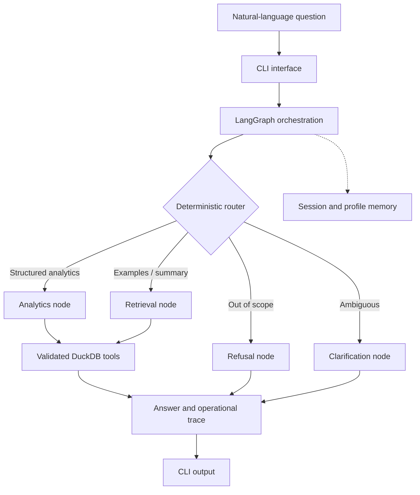
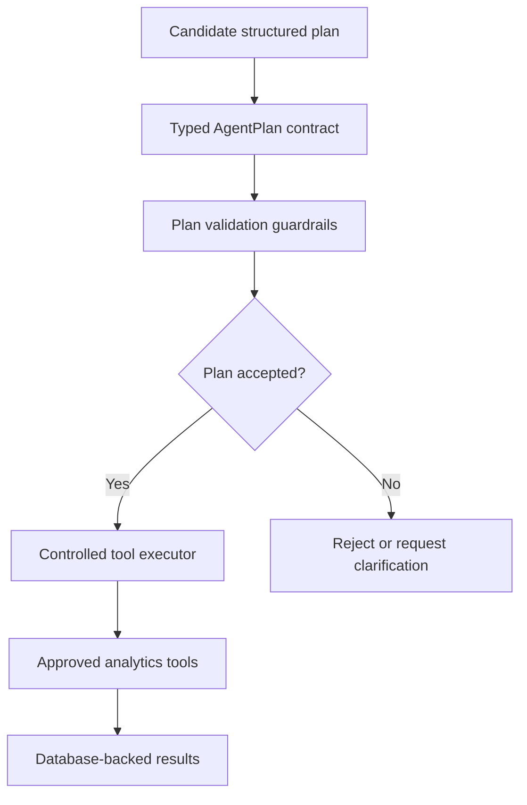

<div align="center">

# Customer Service Analyst System

### LangGraph-Powered Customer Support Analytics Agent

**Python · LangGraph · DuckDB · FastMCP · Pydantic · pytest**

*Reliable answers to customer-support business questions, backed by validated data tools.*

[Repository](https://github.com/Majd17Massalha/customer-service-analyst-system) · [Planning Components](https://github.com/Majd17Massalha/customer-service-analyst-system/tree/feature/openai-llm-planner)

</div>

---

## Overview

The **Customer Service Analyst System** is a working, modular analytics agent for the Bitext Customer Support dataset. It lets users ask questions in natural language and receive reproducible statistics, relevant examples, and extractive summaries without writing SQL.

The system uses **LangGraph** to orchestrate a deterministic workflow and **DuckDB** as the source of truth for numerical results. A separate **FastMCP** interface makes analytics tools available to compatible external clients. Structured planning contracts, validation guardrails, and controlled execution components extend the codebase's agent engineering foundation.

### Key Capabilities

- **Agent orchestration:** LangGraph routes requests to analytics, retrieval, clarification, or refusal paths.
- **Verified business analytics:** Parameterized DuckDB tools calculate counts, filters, and category/intent distributions.
- **Tool interoperability:** FastMCP exposes validated analytics operations through a separate server.
- **Safe execution boundaries:** Typed inputs, constrained tool access, and explicit out-of-scope handling.
- **Observability and memory:** Operational traces and bounded session/profile metadata.
- **Testable engineering:** Automated regression, validation, and adversarial test coverage.

## Business Problem

Customer-support teams need to understand issue volumes, recurring categories, customer intents, and representative requests. Manual analysis requires SQL expertise; unconstrained language-model responses may invent counts or percentages.

**The solution separates natural-language request handling from trusted data execution.** LangGraph chooses an approved workflow; DuckDB computes analytical values; the system returns results with operational trace information. This architecture prioritizes correctness, reproducibility, and maintainability.

## Architecture

### Operational Agent Workflow



**Implementation map:**

| Responsibility | Module |
| --- | --- |
| CLI entry point | `main.py` |
| Interactive CLI | `src/cli/chat_loop.py` |
| LangGraph workflow | `src/agent/graph.py` |
| Request routing | `src/agent/router.py` |
| DuckDB analytics | `src/tools/analytics_tools.py` |
| MCP server | `src/mcp/server.py` |
| Session persistence | `src/memory/checkpoints.py` |
| Profile persistence | `src/memory/user_profile.py` |

The operational routing workflow uses deterministic logic; supported analytical queries do not require an external LLM API.

### Structured Planning and Execution Design

The [`feature/openai-llm-planner`](https://github.com/Majd17Massalha/customer-service-analyst-system/tree/feature/openai-llm-planner) branch contains **typed `AgentPlan` contracts**, **plan-validation guardrails**, and a **controlled tool executor**. These components define how candidate plans are checked before approved analytics tools can be invoked.



**Architecture boundary:** The diagram documents the structured plan-validation/execution components on the feature branch. It does not imply that LLM-generated plans are already connected to the primary CLI workflow. Model-driven plan generation is an optional enhancement to the operational deterministic agent.

### MCP Integration

`src/mcp/server.py` provides an independent **FastMCP** server for the analytics tools, with Pydantic-validated inputs. Compatible MCP clients can use this boundary to call the available tools; the repository does not claim a live third-party customer deployment.

## Reliability, Security, and Governance

| Concern | Engineering control |
| --- | --- |
| Incorrect numerical claims | Numerical answers originate from DuckDB operations |
| SQL injection | Parameterized queries and validated inputs |
| Unsupported questions | Explicit refusal and clarification routes |
| Unexpected plan actions | Typed plan contract, validation rules, approved tool execution |
| Session path abuse | Sanitized session identifiers |
| Sensitive profile storage | Restricted structured profile fields, excluding raw observations |
| Debugging and review | Operational traces with route, tool, input, observation, and answer fields |
| Regression risk | Automated tests and adversarial query scenarios |

These controls support robust local engineering; they are not a claim of external security certification or multi-tenant production deployment.

## Memory Design

- **Session memory:** `src/memory/checkpoints.py` persists bounded interaction metadata as local JSON files.
- **Profile memory:** `src/memory/user_profile.py` records selected structured preferences and filters, not raw dataset observations.
- **Storage:** Local files under `outputs/memory/`; session IDs identify local state rather than authenticated users.

## Quick Start

**Prerequisites:** Python 3.10+ and Git.

```bash
git clone https://github.com/Majd17Massalha/customer-service-analyst-system.git
cd customer-service-analyst-system
python -m venv .venv
```

Activate the virtual environment:

**Windows PowerShell**

```powershell
.\.venv\Scripts\Activate.ps1
```

**Linux / macOS**

```bash
source .venv/bin/activate
```

Install dependencies, ingest data, and run the agent:

```bash
python -m pip install -r requirements.txt
python -m src.data.ingest
python main.py --session demo
```

The ingestion step retrieves the **Bitext Customer Support** dataset from Hugging Face and creates a local DuckDB database in `outputs/`. The documented snapshot contains **26,872 synthetic support records**. The initial download requires an internet connection.

### MCP Server

Run the MCP server separately from the CLI:

```bash
python -m src.mcp.server
```

Connect it using the configuration supported by your MCP client.

## Example Business Questions

| Example question | System behavior |
| --- | --- |
| How many total rows are there? | Count records using DuckDB |
| How many billing queries are there? | Apply a category filter and return a count |
| How many cancellation intents exist? | Count matching intents |
| What are the top categories? | Return category distribution |
| Show me examples about refunds | Retrieve matching support examples |
| Summarize shipping complaints | Produce an extractive summary from retrieved records |
| What is the weather in Paris? | Return an out-of-scope response |

These are illustrative supported-query examples, not copied CLI output or measured performance results.

## Testing and Evaluation

Run the automated suite:

```bash
python -m pytest tests/ -q
```

**Most recently reported result:** **243 passing tests** on the `feature/openai-llm-planner` branch. Test totals may vary by branch or subsequent commits; the current result should be checked before sharing the repository.

The engineering workflow uses regression tests, adversarial prompts, security-oriented validation, and operational traces to examine routing and tool behavior. LLM-as-a-Judge templates, where present, are evaluation scaffolding rather than measured model-quality results.

## Design Decisions and Scope

- **Deterministic numerical analytics:** Database operations—not generated prose—produce counts and distributions.
- **Extractive text summaries:** Retrieval-based summarization is used for the current runtime.
- **Static sample data:** The Bitext dataset is synthetic and does not represent a live support integration.
- **Local persistence:** DuckDB and JSON memory are appropriate for a local demonstrator, rather than a distributed multi-tenant service.
- **Clear execution boundaries:** Structured planning components validate proposed actions before execution; the CLI's operational workflow remains deterministic.

## Continuous Improvement & Roadmap

The working analytics agent provides a foundation for further capabilities:

1. **Model-assisted planning:** Connect LLM-generated structured plans to the existing plan contract, validation rules, and controlled executor, with end-to-end tests.
2. **Evaluation and benchmarking:** Quantify routing quality, tool selection, failure handling, latency, and cost on a reproducible benchmark set.
3. **Semantic retrieval:** Add embedding-based exploration of support text while preserving DuckDB as the authority for numerical answers.
4. **Deployment capabilities:** Add authentication, managed storage, monitoring, and deployment automation for larger-scale environments.
5. **Business reporting:** Explore exportable reports, time-based analysis with enriched data, and dashboard integration.

## AI-Assisted Engineering Process

Claude Code was used as a development copilot for implementation support. Architectural decisions and code changes were reviewed against design boundaries and validated through testing and CLI checks. Use of an AI coding assistant is distinct from the runtime's deterministic query-processing design.

---

**Repository:** https://github.com/Majd17Massalha/customer-service-analyst-system  
**Structured planning branch:** https://github.com/Majd17Massalha/customer-service-analyst-system/tree/feature/openai-llm-planner
